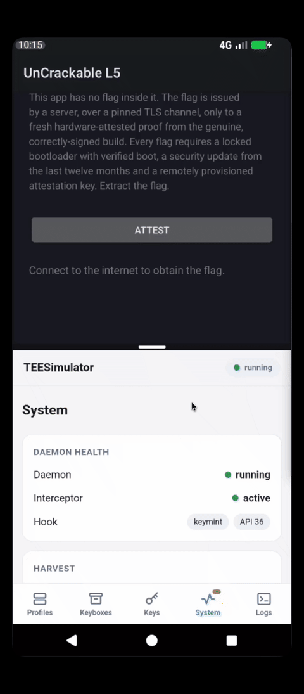

## Intro

Some friends and I were enjoying [Dio's](https://github.com/diolor) talk at masCon Berlin 2026, titled *"You Are Already Compromised: Why Attestation Is the Foundation of Mobile Security"*. He discussed how key attestation can protect apps without trusting the devices they run on. Dio ended his talk by throwing down the gauntlet and introducing a new future entry in the MAS Uncrackable series: [**Uncrackable L5**](https://github.com/Diolor/uncrackable-l5-demo) for Android.

Unsurprisingly, a challenge is a challenge, and I couldn't wait to get my hands on it and giving it a try (**spoiler**: getting the flag didn't take long 🙈). In this article, we'll discuss key attestation for Android apps and how even the strictest remote checks can fall short against advanced attackers.

In the end, the key lesson is simple: **passing key attestation does not mean an app is free from runtime tampering**. In this article we will learn why this is the case through this challenge.

## The Challenge

The premise of the challenge is simple yet effective: the flag is not hardcoded into the app but delivered by its backend. Normally this would be easy to beat, but there's a catch: the backend only gives you the flag once it has successfully completed [key attestation](https://developer.android.com/privacy-and-security/security-key-attestation) and verified that the following requirements are met:

- **Hardware key attestation support (TEE or StrongBox)**: Although they refer to different technologies, the terms TEE and StrongBox will be used interchangeably below for readability. The differences between the two are discussed [later on](#attestation-core-concepts).
- **Remote Key Provisioning (RKP)**: Only Google-attested RKP attestation keys are allowed, whereas traditional factory attestation keys are rejected by the backend. RKP is Google's solution for provisioning devices with device-specific, short-lived attestation keys. Take a look at [Google's RKP](https://android-developers.googleblog.com/2022/03/upgrading-android-attestation-remote.html) announcement post if you want to learn more about the difference between factory and RKP keys.
- **Recent Security Patch**: The device must have a security patch no older than a year.
- **Locked Bootloader**: The device must be running stock firmware.

Below is a diagram summarizing how the challenge flow works:


*UnCrackable L5 overview*

That's it: the challenge does not actively check for any other indicators of compromise on the device, such as root access, hooking, or debugging. Its security relies entirely on the key attestation model. If we run the challenge on a clean, stock Pixel 7 device running Android 17, we get a successful result but no flag.


*Running UnCrackable L5 on a clean device*

We'll need to intercept the app's traffic to get it. To achieve this, attackers usually apply one of these techniques:
- **Patch and re-sign the app**: For example, modifying the app to disable [certificate pinning](https://mas.owasp.org/MASTG/knowledge/android/MASVS-NETWORK/MASTG-KNOW-0015/) so a tool such as [mitmproxy](https://mas.owasp.org/MASTG/tools/network/MASTG-TOOL-0097/) can be used to intercept traffic.
	- **Assumption**: Key attestation prevents this by having the backend check the app's signature included in the attestation chain.
- **Hooking**: Using a tool such as [Frida](https://mas.owasp.org/MASTG/tools/generic/MASTG-TOOL-0031/) to apply the same patches dynamically at runtime.
	- **Assumption**: Key attestation prevents this because hooking requires either a compromised environment or a patched app, and the backend checks for both during attestation.
- **Modified firmware**: Running modified Android firmware that allows for transparent network traffic inspection.
	- **Assumption**: Running modified firmware breaks [Android's Verified Boot](https://source.android.com/docs/security/features/verifiedboot) state, which is verified by the backend during attestation.

Before we move forward with the challenge, let's take a quick detour to look at how key attestation works in Android.

## Attestation Core Concepts

Before looking at the attacks, it helps to separate three related concepts: key attestation, Remote Key Provisioning, and Play Integrity. They serve different purposes, even though they share parts of Android's security infrastructure.

### Key Attestation (KA)

Android's key attestation lets a backend verify the properties of a cryptographic key and the environment in which it was generated. Instead of trusting whatever the app reports about its device, the backend receives a certificate chain containing signed information it can verify.

For hardware-backed keys, cryptographic operations take place inside a Trusted Execution Environment (TEE) or StrongBox.
- **TEE**: Provides an execution environment isolated from the normal Android OS logically, not physically. An implementation example is Qualcomm's QSEE, based on [ARM TrustZone](https://support.arm.com/compute-ip/trustzone-for-cortex-a).
- **StrongBox**: Uses a dedicated security component with stronger isolation requirements. Both are designed to keep private key material outside the reach of the app and the Android OS. A StrongBox implementation example is Google's Titan M2 security chip.

This challenge app is the perfect example of what a typical attestation flow looks like. As we saw at the beginning of the article when exploring the challenge, key attestation goes something like this:
 1. The backend sends the app a fresh, unpredictable challenge.
 2. The app asks Android Keystore to generate a keypair, including that challenge in its attestation request.
 3. The device returns a certificate chain that binds the public key to the attestation information. This includes the challenge, key properties, and information about the device and requesting app.
 4. The app sends the chain to the backend, which validates it and checks whether the attested properties meet its requirements.

There are two different types of keys involved here. On the one hand, there's the keypair being attested specifically for this app. On the other hand, the device's attestation private key signs the certificate containing the evidence, with a certificate chain leading back to a root the backend trusts.

### Remote Key Provisioning (RKP)

Under the older model, manufacturers provisioned long-lived attestation keys at the factory. With RKP, attestation keys are generated inside the device's TEE, and Google's provisioning service certifies their public keys.

The resulting certificates are short-lived and renewed through the provisioning process. This reduces reliance on factory-provisioned secrets and limits how long compromised credentials remain useful without renewal.

### Play Integrity (PI)

Play Integrity is Google's service for assessing app and device integrity. Rather than directly validating an Android Keystore attestation chain, the developer's backend receives integrity verdicts through Google's API.

These verdicts cover signals such as whether Google Play recognizes the app, whether it was installed through Google Play, and whether the device meets specific integrity requirements. Hardware-backed attestation contributes to some of these checks, but Play Integrity and key attestation are not interchangeable. For example, PI also performs local root checks.

UnCrackable L5 uses key attestation directly, not Play Integrity. Its backend evaluates the certificate chain and applies its own acceptance policy, which is what we'll focus on below.

## Attacks Against Key Attestation: Where the Chain Breaks

Rather than trusting the device's normal-world OS, placing trust in its TEE and the developer's backend is a better approach than simply believing whatever information the OS hands to your RASP. Nevertheless, attestation relies on a few principles:
- **The TEE does not lie**: The TEE is a secure environment isolated from the normal-world OS that cannot be tampered with. Thus, all information it generates is trusted, including the attestation certificate chain and its contents (e.g. Verified Boot state and bootloader status).
- **TEE-backed keys cannot be extracted**: Once a key is generated inside a device's TEE, it cannot be extracted or used outside it. All cryptographic operations using this key, such as encryption, decryption, or signing, must be performed inside the TEE so that the sensitive key material never leaves this secure environment.
- **The TEE holds valid attestation keys**: The TEE holds an attestation keypair it uses to sign the certificate chain requested by the app. These keys can either be provisioned to the device at the factory (long-lived, old model) or generated by the device and attested by Google's backends (short-lived, new RKP model). Neither type can be forged. As we already mentioned, this challenge only allows devices using the newer attestation model.
- **The backend validates attestation properly**: Attestation certificates contain many fields that the backend should check to assess the security posture of the client device trying to establish a connection. These include the device's boot state, security patch date, the hash of the client app's signing certificate, and the expiration date of the attestation key used.

If you are interested in reading more about how missing or partially implemented attestation can affect an application, take a look at the related entries in OWASP's MASWE list (always worth a read!):
- [MASWE-0054: Device Attestation Not Implemented](https://mas.owasp.org/MASWE/MASVS-RESILIENCE/MASWE-0054/)
- [MASWE-0056: App Attestation Not Implemented](https://mas.owasp.org/MASWE/MASVS-RESILIENCE/MASWE-0056/)

Well, now that we know the basics of key attestation and how the challenge works, let's explore how the security assumptions we discussed can fail, allowing us to get the flag (that's what we're here for, isn't it?).

### *"The TEE does not lie"*: What If You Replace the TEE Altogether?

The Android modding community is jam-packed with rooting solutions such as [Magisk](https://github.com/topjohnwu/magisk), [KernelSU](https://github.com/tiann/kernelSU), SukiSU, [APatch](https://github.com/bmax121/APatch), and FolkPatch, to name just a few. There are also dozens of public root-hiding solutions that patch Android to make it lie about its inner workings, such as [TreatWheel](https://github.com/PerformanC/Treat-Wheel-Zygisk) or [HMA-OSS](https://github.com/frknkrc44/HMA-OSS). TEEs, on the other hand, are not as easy to tamper with, as they don't generally offer a way to run custom, unsigned code inside them.

So, how have community members managed to run their favorite banking applications or games that implement attestation on rooted devices? The answer is: just **replace the TEE**! Tools such as [TrickyStore](https://github.com/5ec1cff/TrickyStore), [TEESimulator](https://github.com/JingMatrix/TEESimulator) or [OMK](https://github.com/qwq233/OhMyKeymint) try to provide a reliable software-backed implementation of the [KeyMint Trusted Application (TA)](https://source.android.com/docs/security/features/keystore#glossary) running inside the TEE. They then intercept the requests going from the Android OS to the real TEE and fulfill them completely in software. The app requesting the hardware-backed cryptographic operations never knows whether a real or fake TEE processed its request. Furthermore, since these tools can have full control over the attestation process, users can specify whatever attestation metadata they want, such as the device manufacturer, device model, or security patch date.

Here is a diagram showing an overview of how TEESimulator works. "Generation mode" is generally used with devices that don't have a working TEE (e.g. emulators), whereas "Patch mode" is intended for devices with unlocked bootloaders.


The attentive reader may have noticed that this solution is not enough to break key attestation on its own: the spoofed TEE still needs valid attestation keys to generate attestation certificate chains rooted in a Google certificate authority. Since these are not exactly "easy" to forge, we'll see in the following sections how the community gets around this limitation.

### *"TEE-backed keys cannot be extracted"*: Keyboxes All the Way!

The whole point of doing cryptography inside a TEE is that private keys never leave its protection. Getting root on Android does not, by itself, change that. But “non-exportable” is a security property enforced by an implementation. What happens when that implementation breaks?

Sometimes, the keys leak before the TEE can protect them. For factory-provisioned keys (old model), manufacturers handle them outside the device before they are provisioned. Unfortunately, mistakes in this process can lead to the keys leaking to the internet, sometimes ending up in shady Telegram groups that either sell access to them or give them away for free. The distribution format for these keys is known online as "keyboxes" and is one of the main reasons why Google completely overhauled the Android attestation model. In [this blog post](https://www.guardsquare.com/blog/bypassing-key-attestation-api), Guardsquare showed a real example of this issue: a firmware package for an Android device contained a new set of attestation keys that could be easily extracted and reused on a different device.

> [!NOTE]
> Attestation keys using the new RKP model can also be leaked through TEE attacks, but they have a much shorter validity period than their non-RKP counterparts (e.g. a few days rather than years).

Sometimes, the attacker **doesn't even need to extract anything**. Several attack techniques made public recently leave the protected key secret but tamper with the data being signed instead, making that data untrustworthy:
- **Boot-chain vulnerabilities**: Exploits such as [kaeru](https://github.com/R0rt1z2/kaeru) make the bootloader lie about its unlock status so the attestation certificates generated by the TEE are clean.
- **Signing oracle attacks**: If the TEE does not properly verify that the keypair being attested is actually inside the TEE, the attacker can request key attestation for any key they control. As a result, the attacker is left with a Google-attested key they can use on any other device. This vulnerability has been identified in the KeyMint TA implementation of some modern Qualcomm-based devices, and it is currently being exploited to mint attacker-controlled RKP attestation keys. The original post describing the vulnerability can be found [here](https://bbs.kanxue.com/thread-293244.htm), and tools such as [Duck-Toolbox](https://github.com/eltavine/Duck-ToolBox) already implement the attack.

To mitigate the risk of keys being leaked, extracted, or misused, Google maintains a [revocation list](https://android.googleapis.com/attestation/status), which it uses to block attestation attempts from devices using any of the listed keys. The list is used by Google's Play Integrity service but can also be used by developers implementing their own key attestation procedures.

### *"The backend validates attestation properly"*: Is this always true?

Let's assume the TEE does not lie, its keys cannot be extracted, and the attestation keys it holds are valid. We should be safe now, right? Well, someone still needs to check all that information on the other end without making mistakes, and this is where the backend comes into play.

The backend needs to validate the certificate chain against a trusted attestation root, check its validity and revocation status, and then inspect the information included in it. Missing any of these checks may leave an attacker with a way around the whole thing:
- **Not checking who signed it**: The root certificate needs to be known and trusted by the backend.
- **Not checking revocation**: The backend needs to check whether the attestation keys used have been revoked (e.g. after being leaked).
- **Not checking freshness**: Avoid replay attacks by verifying that the certificate chain contains the challenge nonce sent to the client.
- **Not checking attestation claims**: The TEE may claim the device has an unlocked bootloader, but the backend still needs to define and enforce a policy that, for example, rejects such devices.

(Un)fortunately, the backend for this challenge does its due diligence and verifies all relevant fields of the attestation certificate chain, such as the app signature, certificate root, attestation key type, and device unlock status.

## Getting the Flag: I Swear This Device Is Not Rooted!

Now that we know how the challenge works and how key attestation can be bypassed, it's just a matter of intercepting the app's TLS traffic without breaking the attestation process. In this section, we'll cover two ways to get the flag. The first uses only a Google Pixel 7 device running Android 17 that has been rooted using the public [Root-My-Pixel](https://github.com/alex193a/Root-My-Pixel) jailbreak. The second uses a rooted, virtual Android 16 device running TEESimulator with a leaked RKP keybox. A third solution will be covered in a follow-up article, where we'll show a rooted, emulated device with broken attestation that relays all attestation requests to a rooted Google Pixel device.

> [!NOTE]
> *Rooting* and *jailbreaking* an Android device are different procedures. The former involves unlocking the device's bootloader to patch system partitions and gain root access. The latter exploits security flaws in the device's firmware to gain root access without making any persistent modifications.

### Solution 1: Device Rooted Through Local Privilege Escalation

This setup is the simplest one. We can retain working key attestation by obtaining root access to the device using a privilege escalation exploit rather than unlocking the bootloader and modifying system partitions.


*Root-My-Pixel launch screen*

This way, the bootloader reports a clean, locked state even though we have root access. The bootloader is not lying here: it is indeed locked, and the device is running a trusted, signed firmware image.


*Running UnCrackable L5 on a jailbroken device: Root access*


*Running UnCrackable L5 on a jailbroken device: Working RKP attestation*

Once we have root access, we can use any method we prefer to obtain the decrypted TLS traffic. To avoid dealing with certificate pinning, we directly hooked the BoringSSL cryptographic primitives used by the Conscrypt security provider to encrypt and decrypt TLS traffic. More specifically, we used Frida to hook the `SSL_READ` and `SSL_WRITE` functions in BoringSSL's `libssl.so` library.

```js
let hooked = false;

Process.attachModuleObserver({
  onAdded(module) {
    if (hooked || module.name !== "libssl.so") return;
    hooked = true;

    Interceptor.attach(module.getExportByName("SSL_write"), {
      onEnter(args) { this.buf = args[1]; },
      onLeave(retval) {
        const length = retval.toInt32();
        if (length > 0) console.log("[SSL_write]\n" + hexdump(this.buf, { length, header: false, ansi: false }));
      }
    });

    Interceptor.attach(module.getExportByName("SSL_read"), {
      onEnter(args) { this.buf = args[1]; },
      onLeave(retval) {
        const length = retval.toInt32();
        if (length > 0) console.log("[SSL_read]\n" + hexdump(this.buf, { length, header: false, ansi: false }));
      }
    });

    console.log("[+] Hooked SSL_write and SSL_read in " + module.path);
  }
});
```


*Running the frida script, extracting and decoding the flag*

And there's the flag :).

### Solution 2: TEESimulator + Keyboxes

This solution will not always be available since it requires getting your hands on a leaked, unrevoked RKP keybox. At the time of writing, several are publicly available online, but this is not always the case. Attackers can just import the keybox XML file into their TEE-spoofing tool of choice (TEESimulator, OMK, TrickyStore, etc.) and get working attestation.


*Working RKP attestation on a [Cuttlefish](https://source.android.com/docs/devices/cuttlefish) virtual device using a keybox leaked from a Realme device.*



*Enabling the Uncrackable L5 app as a TEESimulator target.*

Using the same Frida script as before, we get the decrypted TLS traffic and the same flag sent by the backend.

## Final Thoughts

The real value of this challenge is educational: it helps us understand how key attestation works in Android and where this design falls short. Once the setup is ready, getting the flag becomes trivial.

Key attestation is still a useful security control. It raises the bar for attackers and blocks several common approaches, but it should not be the only security measure in place.

The approach here is **defense in depth**. Combine attestation with other local runtime protections, such as environment checks (anti-root, anti-hooking, etc.), and monitor for abuse on the backend. Each control has its limitations, but bypassing one should not make all the others irrelevant.

OWASP covers device and app attestation in its Mobile Application Security Weakness Enumeration (MASWE) list, including their associated weaknesses and mitigations:
 - [**MASWE-0054**](https://mas.owasp.org/MASWE/MASVS-RESILIENCE/MASWE-0054/): Device Attestation Not Implemented
 - [**MASWE-0056**](https://mas.owasp.org/MASWE/MASVS-RESILIENCE/MASWE-0056/): App Attestation Not Implemented

Finally, test the assumptions behind your protections, not just whether they are enabled. We clearly observed that passing attestation does not mean the app is free from runtime tampering.
